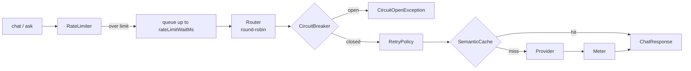

<p align="center">
  <em>Calling an LLM in a demo is one line. Calling it in production is a different sport.</em>
</p>

<p align="center">
  
  
  
</p>

---

A single backend goes down, latency spikes, a provider starts returning 429s — and
your feature is broken. Nexus is the layer between your code and the provider that
absorbs that: routing, caching, retry, circuit breaking, rate limiting and metering,
all on the JDK.

## Quick start

```java
import nexus.Nexus;
import nexus.routing.RoundRobinRouter;
import nexus.resilience.*;

Provider a = new ScriptedProvider("backend-a", script);   // your real provider in prod
Provider b = new ScriptedProvider("backend-b", script);

Nexus nexus = Nexus.builder()
        .providers(List.of(a, b))
        .router(new RoundRobinRouter())
        .retryPolicy(new RetryPolicy())
        .circuitBreaker(new CircuitBreaker())
        .cache(new SemanticCache())
        .meter(new Meter())
        .build();

String answer = nexus.ask("gpt-4o-mini", "Summarise this ticket.");
System.out.println(answer);
System.out.println(nexus.meter().snapshot());
```

```bash
javac -d build $(find src/main/java -name '*.java')
java -cp build nexus.examples.GatewayDemo    # 全离线，脚本化 provider
```

## What is in the gate

| Piece | Role |
|---|---|
| `Router` / `RoundRobinRouter` | pick a backend per request |
| `RetryPolicy` | retry transient failures with backoff |
| `CircuitBreaker` | stop calling a backend that keeps failing (`CircuitOpenException`) |
| `RateLimiter` | cap request rate, with optional `rateLimitWaitMs` |
| `SemanticCache` | reuse a response for a similar request |
| `Meter` | token counts, latency, per-provider stats |
| `SseParser` / `StreamChunk` | stream a response token by token |

Providers: `OpenAiProvider` (real, SSE streaming), `ScriptedProvider` (deterministic),
`EchoProvider` (smoke).

## Request path



The order is deliberate: rate limiting happens before routing so a throttled
request never consumes a backend slot, and the breaker is consulted before retry so
a dead backend fails fast instead of being retried into a longer outage.

## Install

Plain Java 21 source — copy `src/main/java/nexus` into your module. Nothing else on
the classpath.

## Tests

```bash
java -jar junit-platform-console-standalone-1.10.2.jar --class-path build --scan-class-path
```

39 JUnit 5 cases, all offline.

## Limitations

- **`SemanticCache` matches surface text similarity, not meaning.** Two paraphrases
  of the same question will not hit. It is a threshold on lexical overlap.
- **The circuit breaker and rate limiter are per-process.** Ten instances each have
  their own; there is no shared state. For a global limit you need Redis or similar,
  which this library does not provide.
- **`Meter` numbers are local counters.** No persistence, no aggregation across
  processes — scrape them into your metrics system yourself.
- **Retry is not idempotency-aware.** It retries on transport failures regardless of
  whether the call was safe to repeat. Decide that at the call site.
- **No published benchmark numbers.** The repo ships no throughput or latency
  measurements, and this README does not invent any.

## License

MIT
